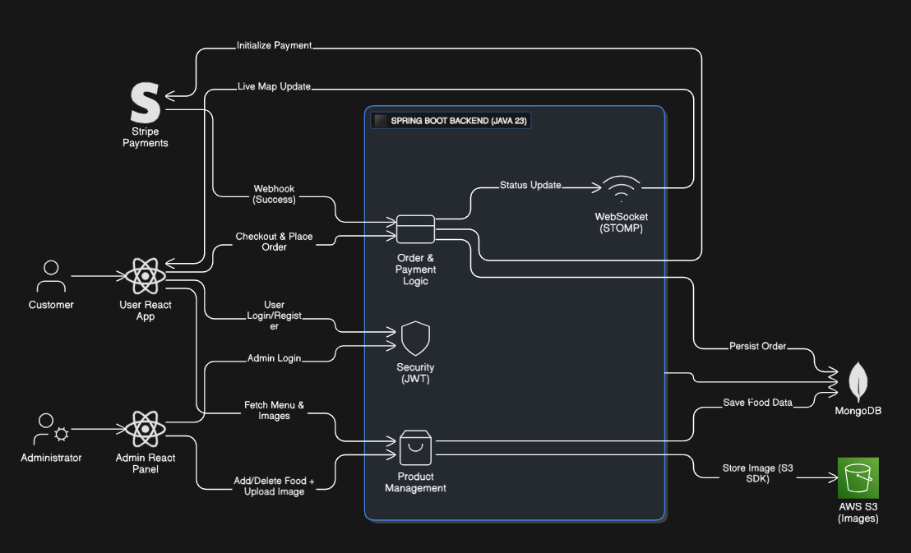

# MASALABOX FOOD ORDER MANAGEMENT SYSTEM (FULL-STACK)

A robust three-tier food delivery application designed for seamless user ordering, real-time order tracking, and secure administrative management.
Built with a modern full-stack architecture focusing on security, data integrity, and scalability.

---

### Key Highlights

- Secure User & Admin Authentication
- Live Order Tracking (Normal Tracker) with real-time driver movement
- Secure Razorpay Checkout Integration
- Dedicated Admin Panel for order & product management
- Cloud-based image storage using AWS S3

---

## FEATURES

### USER FEATURES

- **Authentication:** Secure login and registration using **JWT**.
- **Cart Persistence:** Shopping cart contents are persistently stored in the database.
- **Secure Checkout:** Integrates **Razorpay Checkout** with server-side order creation and signature verification.
- **Order Tracking:** View complete history of past orders with current **status updates**.
- **Order Details Modal:** Detailed modal breakdown showing itemized prices, subtotal, tax, shipping, and grand total.
- **Reorder Functionality:** Quickly add items from a previous order back to the current cart.
- **Image Optimization:** Product and menu images are served securely from **AWS S3** for fast delivery.

### ADMIN FEATURES

- **Admin Login & Registration:** Secure admin authentication with role-based access.
- **Dashboard Overview:** View a list of all user orders (`/api/orders/all`).
- **Status Management:** Update order status (e.g., _Food Preparing_, _Out for Delivery_)
- **Automatic Delivery Completion:** When live tracking reaches destination: Order status automatically updates to Delivered, Live tracking map closes on the user side.
- **Food Management (CRUD):** List All Food Items (View all available food products in a dedicated admin table), Add New Food (Create new food items with: Name, Description, Price, Category, Image upload (AWS S3)), Delete Food (Remove food items from the menu).
- **Customer Data Retrieval:** View customer contact details (Address, Phone, Email) via a specialized modal without exposing them in the main table view.
- **Cloud Asset Management:** Upload and manage product images directly via **AWS S3** integration.
- **Indian Hotel Menu:** An 85-item menu manifest covers popular biryani, South Indian, North Indian, thali, street food, Indo-Chinese, dessert, and beverage favourites.

---

## SECURITY HIGHLIGHTS

- **Server-Side Price Validation:** The final order amount, tax, and shipping are securely calculated on the server using database prices, preventing client-side manipulation.
- **Data Robustness:** Logic implemented to handle concurrent requests and prevent database crashes from duplicate cart records.
- **Token-Based Access:** All order and cart endpoints require a valid **JWT** (authenticated user).
- **Cloud Storage:** Food images are stored in **AWS S3** and their object URLs are saved with the food records.

---

## TECH STACK

### BACKEND (`foodiesapi`)

| Technology          | Description                            |
| ------------------- | -------------------------------------- |
| **Language**        | Java 27                                |
| **Framework**       | Spring Boot 3.5.15                     |
| **Database**        | MongoDB                                |
| **Cloud Storage**   | AWS S3 (Amazon Simple Storage Service) |
| **Security**        | Spring Security 6 (JWT Authentication) |
| **Payment Gateway** | Razorpay Checkout API                 |
| **Realtime**        | WebSocket (STOMP + SockJS)             |

### FRONTEND (`foodies` & `adminpanel`)

| Technology            | Description                              |
| --------------------- | ---------------------------------------- |
| **Library**           | React.js (Functional Components & Hooks) |
| **Styling**           | Bootstrap 5                              |
| **Routing**           | React Router DOM                         |
| **State Management**  | React Context API (Global State)         |
| **Cloud Integration** | AWS S3 for media storage and delivery    |
| **Maps**              | React-Leaflety                           |
| **Realtime**          | STOMP + SockJS                           |

## PROJECT STRUCTURE

Food-Order-Management-System/
── adminpanel/ # FRONTEND: Admin Interface
── foodies/ # FRONTEND: User Interface
── foodiesapi/ # BACKEND: Spring Boot API
── package.json
── README.md

## SYSTEM ARCHITECTURE



---

## SETUP AND INSTALLATION

This assignment setup uses MongoDB Atlas rather than a local MongoDB server. The backend is configured for the Java 27 runtime available on the development Mac, and the Docker image uses the matching Eclipse Temurin 27 images.

### 1. DATABASE AND ENVIRONMENT

- Use a **MongoDB Atlas** cluster. The backend reads the Atlas connection string from `MONGODB_URI` in the local `.env` file.
- Keep `foodiesapi/src/main/resources/application.properties` in place; it loads values from the local dotenv-style file `foodiesapi/.env` and also supports shell environment variables.
- Keep the real credentials out of Git. The local `.env` and `application.properties` files are ignored by Git.
- Create the local backend environment file from `foodiesapi/.env.example`:

```bash
cp foodiesapi/.env.example foodiesapi/.env
```

- Edit `foodiesapi/.env` and replace every placeholder with your MongoDB Atlas, AWS S3, JWT, and Razorpay test values.
- The current assignment upload code sends a `public-read` ACL with each S3 object. For this assignment, configure the bucket with ACLs enabled and allow the IAM identity to use `s3:PutObject`, `s3:PutObjectAcl`, and `s3:DeleteObject`. Do not reuse this public-image setup for production without replacing it with private objects and presigned URLs.

Do not commit or paste real values into `README.md`, `application.properties.example`, or source files. Razorpay keys belong only in the backend `foodiesapi/.env` file. The frontend receives the public key ID from the backend when it creates a payment order.

```bash
cp foodiesapi/.env.example foodiesapi/.env
```

### 2. BACKEND SETUP (`foodiesapi`)

```
cd foodiesapi
export JAVA_HOME="$(/usr/libexec/java_home -v 27)"
./mvnw clean package -DskipTests
./mvnw spring-boot:run
```

The API will run at: http://localhost:8080

### 3. FRONTEND SETUP (`foodies` and `adminpanel`)

Install the dependencies once in each frontend directory:

```bash
cd foodies
npm ci

cd ../adminpanel
npm ci
```

Start the customer application on port `5173` because the backend checkout success URL uses that port:

```bash
cd foodies
npm run dev -- --port 5173
```

Start the admin application on port `5174` in a separate terminal:

```bash
cd adminpanel
npm run dev -- --port 5174
```

Open:

- Customer application: http://localhost:5173
- Admin application: http://localhost:5174

### 5. SYNC THE INDIAN HOTEL MENU TO MONGODB + S3

The repository includes a repeatable catalog sync. It logs in through the existing admin API, skips items already present by name and category, downloads each menu image, and sends it through the normal food-upload endpoint. That endpoint writes the food document to MongoDB Atlas and the image to S3, so the script does not need direct database credentials.

Validate the catalog without credentials or network writes:

```bash
python3 foodiesapi/scripts/seed-catalog.py --dry-run
```

After the backend is running and an admin account exists, sync it with credentials supplied only in the shell:

```bash
export API_BASE_URL=http://localhost:8080/api
export ADMIN_EMAIL=your-admin@example.com
export ADMIN_PASSWORD='your-admin-password'
python3 foodiesapi/scripts/seed-catalog.py
```

Run a one-item smoke upload before the full sync if desired:

```bash
python3 foodiesapi/scripts/seed-catalog.py --limit 1
```

The source menu is `catalog/indian-hotel-menu.json`. Image URLs are public Unsplash image URLs used only as seed inputs; the API copies them to the configured S3 bucket during sync. Do not put admin passwords, AWS keys, or MongoDB credentials in the catalog or repository.

### 4. OPTIONAL DOCKER BACKEND

The backend image is configured for Java 27:

```bash
docker build -t masalabox-api:java27 ./foodiesapi
docker run --rm -p 8080:8080 \
  --env-file ./foodiesapi/.env \
  masalabox-api:java27
```

Do not run the local Maven backend and the Docker backend on port `8080` at the same time.

## NOTES

- Ensure both frontends and backend are running simultaneously.

- Use your own Razorpay test keys for development.

- The admin panel and user panel are independent React apps communicating with the same backend.

- Live tracking uses WebSocket-based normal tracker

---

# Developed with passion for clean code, data integrity, and a seamless food ordering experience.
